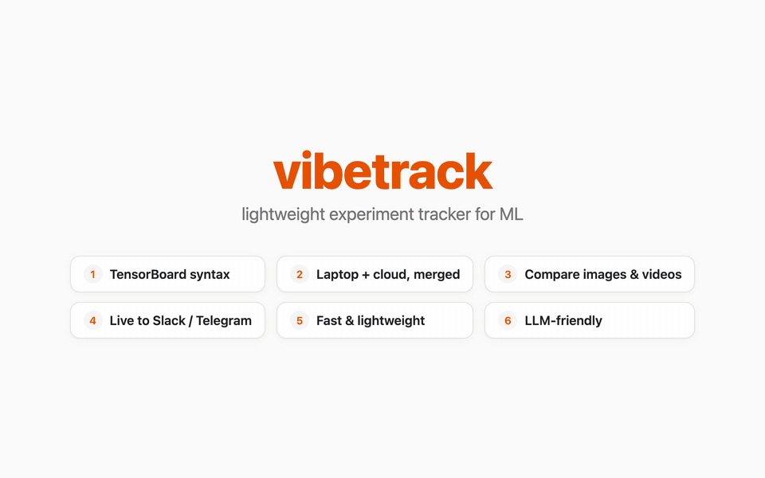

# vibetrack

vibetrack is a lightweight Python experiment tracker. Log metrics, images, and videos with TensorBoard-compatible `SummaryWriter` calls, then explore the same runs in a browser or query them from a coding agent.



- **Compare model outputs.** Use a slider to compare two predictions on the same image. Play videos side by side, pause, and compare the same frame across runs.
- **Follow training live.** Send progress to Slack or Telegram, or display results in a terminal or Jupyter notebook.
- **Bring runs together.** Log to SQLite and local media files on a laptop or cloud worker. Sync runs from both to a shared bucket and compare them in one dashboard.
- **Log scalars quickly.** In the project's single-process benchmark with one million scalar writes, vibetrack logged 41,465 scalars/s, TensorBoard logged 31,521, and MLflow's file store logged 2,565. [Benchmark and reproduction steps](https://github.com/chroneus/vibetrack/blob/main/docs/BENCHMARK.md)

## Install and log your first run

Install the package in the Python environment you use for training. The web dashboard is included.

```bash
python -m pip install vibetrack
```

Save this as `train.py`. It fits one weight to a target of 3 and records how the loss changes at each step. In an existing TensorBoard loop, import `SummaryWriter` from `vibetrack` and keep your `add_scalar(tag, value, step)` calls.

```python
from vibetrack import SummaryWriter

lr = 0.1
weight = 0.0
with SummaryWriter("runs/baseline", project_folder="runs", config={"lr": lr}) as writer:
    writer.define_metric("train/loss", goal="min", primary=True)
    for step in range(20):
        error = weight - 3.0
        writer.add_scalar("train/loss", error ** 2, step)
        weight -= lr * 2 * error
```

Run the script and start the dashboard from the same directory. Open the printed URL to see the loss curve. To compare learning rates, change `lr` and give the second run a new name, such as `runs/lower-lr`.

```bash
python train.py
vibetrack runs
```

## Compare images and videos

At evaluation time, log files your model produced. Use the same input and tag across runs so the comparison lines up.

```python
writer.add_image("eval/prediction", "prediction.png", step)
writer.add_video("eval/rollout", "rollout.mp4", step)
```

In the dashboard's **Images** or **Video** tab, select two outputs and click **Compare**. For videos, pause on a difference and choose **Compare frame as images** to inspect it with the image slider. [Media inputs and logging API](https://github.com/chroneus/vibetrack/blob/main/docs/API.md)

## Send live updates

Attach a destination inside the writer's `with` block, before the training loop. For Slack text updates, set `SLACK_WEBHOOK_URL`. For Telegram, install `python -m pip install 'vibetrack[telegram]'` and set `VIBETRACK_TELEGRAM_TOKEN` and `VIBETRACK_TELEGRAM_CHAT_ID`.

```python
writer.to("slack", every="15m")    # Send a digest every 15 minutes of logging
writer.to("telegram", every=100)   # Send a summary every 100 events
```

Slack also supports media uploads with a bot token and channel. [Viewer setup, credentials, and HTTP forwarding](https://github.com/chroneus/vibetrack/blob/main/docs/VIEWERS.md)

## Combine local and cloud runs

The quick start stores metrics in `runs/vibetrack.db` and media under the run directory. To merge results from several machines into one view, give each machine access to the same S3-compatible bucket and prefix. Replace `s3://ml-runs/team` with your location.

```bash
vibetrack push runs s3://ml-runs/team     # Upload existing runs from this project
VIBETRACK_SYNC=s3://ml-runs/team python train.py  # Sync a run as it trains
vibetrack s3://ml-runs/team               # View all synced runs from your laptop
```

Each machine keeps its local copy. A shared filesystem also works with a URL such as `file:///mnt/shared/runs`. [Storage credentials, provider examples, and offline copies](https://github.com/chroneus/vibetrack/blob/main/docs/STORAGE.md)

## Use vibetrack from a coding agent

After installation, run `vibetrack guide` for the instrumentation checklist. Record the configuration, use a common step for metrics and media, and declare the primary metric and its goal. The writer prints a run summary to stderr when it closes.

From the quick-start directory, these commands return JSON on stdout. Use the same `--project-folder` value that you passed to the writer.

```bash
vibetrack ls --project-folder runs --json
vibetrack show baseline --project-folder runs --json
vibetrack compare --project-folder runs --metric train/loss --goal min --json
```

Use `ls` to discover run names and status, `show` to inspect one run's configuration, metrics, and media paths, and `compare` to rank runs by their best loss. To show the user a result, run `vibetrack open baseline --project-folder runs`.

For an LLM client that supports the Model Context Protocol (MCP), start a standalone server on Python 3.10+.

```bash
python -m pip install 'vibetrack[mcp]'
vibetrack --viewer mcp --project-folder runs --port 6117
```

Connect the client to `http://127.0.0.1:6117/mcp`. Ask it “Which run reached the lowest training loss, at what step, and what learning rate did it use?” The client can answer using `list_runs`, `compare_runs`, and `run_overview`. [MCP tools and client examples](https://github.com/chroneus/vibetrack/blob/main/docs/MCP.md)

## License

[Apache 2.0](https://github.com/chroneus/vibetrack/blob/main/LICENSE)
